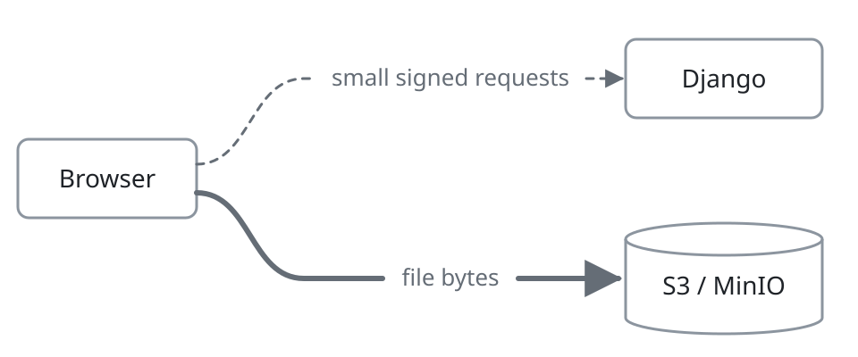

# django-s3-file-field

[](https://pypi.org/project/django-s3-file-field/)
[](https://pypi.org/project/django-s3-file-field/)
[](https://pypi.org/project/django-s3-file-field/)
[](LICENSE)

_Django signs, the browser sends. Skip the bucket brigade._

A Django `FileField` whose uploads send file content straight from the client to
[AWS S3](https://aws.amazon.com/s3/) or [MinIO](https://min.io/), never through the Django server.


## Features

- **A form widget, included.** Swap `FileField` for `S3FileField` and every `ModelForm`,
  including the Django admin, gets an upload widget with progress, cancellation, and drag and
  drop, which keeps its state when the form is redisplayed.
- **REST APIs too.** `ModelSerializer` fields work the same way, with the widget, a JavaScript
  client, or a Python client doing the upload.
- **Fast, resilient transfers.** Files upload in parallel parts, and transient failures are
  retried, so large files survive slow links.
- **Validation of real content.** Validators and `clean_<field>` / `validate_<field>` methods
  receive a readable `File`, so you can inspect what was actually uploaded.
- **Size limits.** A maximum upload size, per field or global, is enforced by the server and
  checked by the widget before an upload starts.
- **Stateless and signed.** No database rows track in-flight uploads; every upload is carried in
  signed, expiring tokens and bound to the field it was initiated for.
- **Themed to match.** The widget inherits the page's font and colors, and follows
  [DaisyUI](https://daisyui.com/) and [Vuetify](https://vuetifyjs.com/) themes out of the box.
- **Accessible.** The widget labels its controls and exposes its status changes to assistive
  technology, via ARIA roles and labels.

## How it works

<picture>
  <source media="(prefers-color-scheme: dark)" srcset="https://raw.githubusercontent.com/kitware-resonant/django-s3-file-field/master/docs/direct-upload-dark.png">
  
</picture>

A file uploaded through Django occupies a worker for the whole transfer: the server must receive
and buffer the entire file before the view even runs, then usually upload it again to the storage
backend. A few concurrent large uploads can exhaust the synchronous workers of a WSGI server such
as [Gunicorn](https://gunicorn.org/design/), and platforms with strict request timeouts, like
[Heroku](https://devcenter.heroku.com/articles/request-timeout), cut long transfers off entirely.
An asynchronous (ASGI) server frees the worker, but still buffers and re-uploads the file.
django-s3-file-field instead moves the file content from the client straight to the bucket:

1. The client asks Django to start an upload to a particular `S3FileField`. Django creates a
   multipart upload in the bucket and returns presigned URLs for the file's parts, along with a
   signed token for the upload.
2. The client sends the file's parts to those URLs, in parallel, directly to the bucket.
3. The client asks Django to complete the upload. Django presigns the bucket's completion request,
   which the client sends, then verifies that the object exists and returns a signed value for
   the field, valid for 24 hours.
4. The client submits that value in place of the file, in an ordinary form or API request. Django
   verifies the value's signature and attaches the object to the model instance, as if the file
   had been uploaded through it.

That is the library's whole scope. Its principal API is the `S3FileField`, a subclass of
[Django's `FileField`](https://docs.djangoproject.com/en/stable/ref/models/fields/#filefield), and
it affects no operation other than uploading from external HTTP clients; for everything else
(downloading, saving files from Python, etc.), refer to
[Django's file management documentation](https://docs.djangoproject.com/en/stable/topics/files/).

## Installation

django-s3-file-field requires Python 3.12 and Django 5.2, or later. The upload widget requires an
evergreen browser (one supporting ES2024 and `ElementInternals`).

django-s3-file-field must be used with a compatible storage backend, one of:
- `S3Storage` in [django-storages](https://django-storages.readthedocs.io/),
  for [AWS S3](https://aws.amazon.com/s3/)
  - This must be explicitly configured (the defaults are insufficient) to use
    [Signature Version 4](https://docs.aws.amazon.com/AmazonS3/latest/API/sig-v4-authenticating-requests.html):

    ```python
    # settings.py
    AWS_S3_SIGNATURE_VERSION = "s3v4"
    ```

- `MinioStorage` or `MinioMediaStorage` in [django-minio-storage](https://django-minio-storage.readthedocs.io/),
  for [MinIO](https://min.io/)

Other S3-compatible services, such as Cloudflare R2, Backblaze B2, or DigitalOcean Spaces, may
work when
[configured as django-storages documents](https://django-storages.readthedocs.io/en/latest/backends/s3_compatible/index.html),
but only AWS S3 and MinIO are tested.

After the storage backend is installed and configured, install django-s3-file-field, using the
corresponding extra:
```bash
pip install "django-s3-file-field[s3]"
```
or
```bash
pip install "django-s3-file-field[minio]"
```

Enable django-s3-file-field as an installed Django app:
```python
# settings.py
INSTALLED_APPS = [
    ...,
    "s3_file_field",
]
```

Add django-s3-file-field's URLconf to the root URLconf; the path prefix (`"api/s3-upload/"`)
can be any path:
```python
# urls.py
from django.urls import include, path

urlpatterns = [
    ...,
    path("api/s3-upload/", include("s3_file_field.urls")),
]
```

### Bucket configuration

Uploads from a browser require a
[CORS configuration](https://docs.aws.amazon.com/AmazonS3/latest/userguide/ManageCorsUsing.html)
on the AWS S3 bucket, compatible with the following (`"AllowedOrigins": ["*"]` is also
acceptable):
```json
[
  {
    "AllowedOrigins": ["https://app.example.com"],
    "AllowedMethods": ["PUT", "POST"],
    "ExposeHeaders": ["ETag"],
    "MaxAgeSeconds": 600
  }
]
```
MinIO requires no explicit CORS configuration, as it allows all origins by default. Non-browser
clients, such as the Python client, don't need CORS at all.

The credentials used by the Django storage backend must be granted at least the following IAM
policy:
```json
{
  "Version": "2012-10-17",
  "Statement": [
    {
      "Effect": "Allow",
      "Action": [
        "s3:GetObject",
        "s3:PutObject",
        "s3:DeleteObject",
        "s3:AbortMultipartUpload"
      ],
      "Resource": "arn:aws:s3:::my-bucket/*"
    },
    {
      "Effect": "Allow",
      "Action": "s3:ListBucket",
      "Resource": "arn:aws:s3:::my-bucket"
    }
  ]
}
```

Optionally, a
[lifecycle rule](https://docs.aws.amazon.com/AmazonS3/latest/userguide/mpu-abort-incomplete-mpu-lifecycle-config.html)
to abort incomplete multipart uploads (typically after 7 days) reclaims the parts of uploads that
were started but never completed, which AWS S3 otherwise stores and bills indefinitely.

## Usage

django-s3-file-field supports both the creation and editing (replacing the referenced file) of
model instances with an `S3FileField`, in either of two usage patterns:
- server-rendered views (including the Django admin), via Django's forms API, where Django
  renders the upload widget and processes its submission;
- RESTful APIs, via Django REST framework's serializer API, where the client uploads and submits
  the result itself.

The model definition is common to both usage patterns. The same browser-side upload widget (the
[`<s3-file-input>` element](#the-s3-file-input-element)) provides a GUI for either usage pattern.

### Models

For all usage, define an `S3FileField` on a Django model, instead of a `FileField`:
```python
from django.db import models
from s3_file_field import S3FileField


class Resource(models.Model):
    blob = S3FileField()
```

`S3FileField` accepts the same options as `FileField`, though a callable `upload_to` receives
`None` as the instance, as the upload begins before any instance exists.

#### Limiting file size

A maximum file size (in bytes) may be set on each `S3FileField`:
```python
from django.db import models
from s3_file_field import S3FileField


class Resource(models.Model):
    blob = S3FileField(max_size=100 * 1024 * 1024)  # 100 MiB
```

A default for all `S3FileField` instances which don't set their own `max_size` may be set globally:
```python
# settings.py
S3_FILE_FIELD_MAX_SIZE = 100 * 1024 * 1024  # 100 MiB
```

When neither is set, the limit is the storage backend's own maximum upload size
(5 TB on AWS S3).

#### Model validators

[Validators](https://docs.djangoproject.com/en/stable/ref/validators/) may be set on an
`S3FileField`. As with any model field, they run when a model instance is validated with
[`full_clean()`](https://docs.djangoproject.com/en/stable/ref/models/instances/#django.db.models.Model.full_clean).

For example:
```python
from django.core.validators import FileExtensionValidator
from django.db import models
from s3_file_field import S3FileField


class Resource(models.Model):
    blob = S3FileField(validators=[FileExtensionValidator(allowed_extensions=["pdf"])])
```

Custom validators may also be defined, receiving the uploaded file as
[a `File`-like value](https://docs.djangoproject.com/en/stable/ref/files/file/#the-file-class).
The value includes attributes for `name` and `size`, along with methods for reading the file
content (though this may download the whole file from the storage backend). A validator is only
called when a file is present; as with any model field, an empty or cleared field skips the
validators entirely.

For example:
```python
from django.core.exceptions import ValidationError
from django.core.files import File
from django.db import models
from s3_file_field import S3FileField


def validate_pdf(value: File) -> None:
    with value.open() as stream:
        if stream.read(5) != b"%PDF-":
            raise ValidationError("Not a PDF file.", code="invalid_type")


class Resource(models.Model):
    blob = S3FileField(validators=[validate_pdf])
```

Note that validators run after the file has already been fully uploaded to the storage backend, so
rejecting it only prevents a reference to the file from being saved; the uploaded file itself
remains in the storage backend.

### Django forms

In this usage pattern, everything is handled by the form layer, as with a Django `FileField`. The
form:
- renders the upload widget, which performs the upload in the browser;
- validates the submitted value;
- redisplays it when another field is invalid;
- keeps, replaces, or clears an existing file on edit;
- assigns the result to the model instance.

The [`<s3-file-input>` element](#the-s3-file-input-element) is never manipulated directly.

When defining a
[Django `ModelForm`](https://docs.djangoproject.com/en/stable/topics/forms/modelforms/),
the appropriate form field will be automatically used:
```python
from django.forms import ModelForm

from .models import Resource


class ResourceForm(ModelForm):
    class Meta:
        model = Resource
        fields = ["blob"]
```

Forms using django-s3-file-field include additional
[assets](https://docs.djangoproject.com/en/stable/topics/forms/media/), which must be rendered
along with the form. Typically, this can be done in any form-containing template as:
```django
<head>
  {# Assuming the form is available in context as "form" #}
  {{ form.media }}
</head>
```

When declaring the field on a plain (non-model) `Form`, use an `S3FormFileField`, whose required
argument `model_field` references the model field it submits to, via
[`Model._meta.get_field()`](https://docs.djangoproject.com/en/stable/ref/models/meta/#django.db.models.options.Options.get_field):
```python
from django.forms import Form
from s3_file_field.forms import S3FormFileField

from .models import Resource


class ResourceForm(Form):
    blob = S3FormFileField(model_field=Resource._meta.get_field("blob"))
```

#### Form validation

A `ModelForm` will run all validators declared on the model field.

Additionally, [Form validation](https://docs.djangoproject.com/en/stable/ref/forms/validation/)
is supported. This provides access to the form's other fields (within `clean()`) and the
`instance` (for a `ModelForm`), which a [model validator](#model-validators) can't see.

Note that if the field is optional (the model sets `blank=True`), the `clean_<field>` method may
also receive `None` or `False` values, indicating empty (no file at all) or cleared (existing file
about to be removed) states, respectively. In all cases of editing an existing instance, a kept file
(where the user didn't modify the field) will re-run form validation, with a `File`-like value of
the existing file.

For example:
```python
from pathlib import PurePosixPath

from django.core.exceptions import ValidationError
from django.core.files import File
from django.db.models.fields.files import FieldFile
from django.forms import ModelForm

from .models import Resource


class ResourceForm(ModelForm):
    def clean_blob(self) -> File:
        blob: File = self.cleaned_data["blob"]
        existing_blob: FieldFile = self.instance.blob
        if not existing_blob:
            # The field is required yet empty, so this must be a new instance
            return blob

        blob_suffix = PurePosixPath(blob.name).suffix
        existing_blob_suffix = PurePosixPath(existing_blob.name).suffix
        # Once a file is saved, it can be replaced, but only with the same extension
        if blob_suffix != existing_blob_suffix:
            raise ValidationError("Cannot change the file's extension.", code="invalid")

        return blob

    class Meta:
        model = Resource
        fields = ["blob"]
```

### REST APIs

In this usage pattern, the application declares its API with a Django REST framework serializer,
using an `S3FileSerializerField` to provide an interface to an `S3FileField`. The application's
client then uploads files with the [`<s3-file-input>` element](#the-s3-file-input-element) (in a
browser) or a [client library](#client-libraries) (in JavaScript or Python), and submits the
resulting values to the application's API.

#### Django REST framework

When defining a
[Django REST framework `ModelSerializer`](https://www.django-rest-framework.org/api-guide/serializers/#modelserializer),
the appropriate serializer field will be automatically used:
```python
from rest_framework import serializers

from .models import Resource


class ResourceSerializer(serializers.ModelSerializer):
    class Meta:
        model = Resource
        fields = ["blob"]
```

When declaring the field on a plain (non-model) `Serializer`, use an `S3FileSerializerField`, whose
required argument `model_field` references the model field it submits to, via
[`Model._meta.get_field()`](https://docs.djangoproject.com/en/stable/ref/models/meta/#django.db.models.options.Options.get_field):
```python
from rest_framework import serializers
from s3_file_field.rest_framework import S3FileSerializerField

from .models import Resource


class ResourceSerializer(serializers.Serializer):
    blob = S3FileSerializerField(model_field=Resource._meta.get_field("blob"))
```

##### Serializer validation

A `ModelSerializer` will run all validators declared on the model field.

Additionally,
[serializer validation](https://www.django-rest-framework.org/api-guide/serializers/#validation)
is supported. This provides access to the request (within `self.context`), the serializer's other
fields (within `validate()`), and the `instance` (for a `ModelSerializer`, when updating), which a
[model validator](#model-validators) can't see.

Note that if the field is optional (the model sets `blank=True`), the `validate_<field>` method may
also receive a `None` value, indicating a cleared (existing file about to be removed) state. In all
cases of partially updating an existing instance, a kept file (where the client omitted the field or
submitted an empty value) will skip serializer validation entirely.

For example:
```python
from django.core.files import File
from rest_framework import serializers
from rest_framework.request import Request

from .models import Resource


class ResourceSerializer(serializers.ModelSerializer):
    def validate_blob(self, value: File) -> File:
        request: Request = self.context["request"]
        if not request.user.is_staff and value.size > 10 * 1024 * 1024:
            raise serializers.ValidationError(
                "Non-staff uploads are limited to 10 MiB.", code="too_large"
            )

        return value

    class Meta:
        model = Resource
        fields = ["blob"]
```

#### The `<s3-file-input>` element

In a web browser, a file is uploaded with the `<s3-file-input>` element: a custom element which
presents a file picker, uploads the chosen file to the storage backend, and provides the resulting
value for the application to submit. It is the same element which the form layer renders as its
widget, so this section is only relevant to the REST APIs usage pattern.

The element is loaded by including its assets (where `/static/` is
[Django's `STATIC_URL`](https://docs.djangoproject.com/en/stable/ref/settings/#std-setting-STATIC_URL)):
```html
<link rel="stylesheet" href="/static/s3_file_field/s3-file-input.css">
<script type="module" src="/static/s3_file_field/s3-file-input.js"></script>
```

It is configured with the following HTML attributes, which are also available as JavaScript
properties (except where noted):

| Attribute              | Property             | Type      | Meaning                                                                                                                          |
| ---------------------- | -------------------- | --------- | -------------------------------------------------------------------------------------------------------------------------------- |
| `base-url`             | `baseUrl`            | `string`  | The URL at which django-s3-file-field's URLconf is included (e.g. `/api/s3-upload/`, or a full URL on another origin)            |
| `field-id`             | `fieldId`            | `string`  | The identifier of the `S3FileField` to upload to, as `<app_label>.<Model>.<field>`                                               |
| `max-size`             | `maxSize`            | `number`  | (optional) The maximum file size, checked before uploading; omit when none is configured                                         |
| `existing-url`         | `existingUrl`        | `string`  | (optional) The URL of the existing file stored in this field (i.e. the output of the serializer)                                 |
| `disabled`             | `disabled`           | `boolean` | (optional) Whether the field is disabled; the field is also disabled by a disabled ancestor `<fieldset>`                         |
| `name`                 | `name`               | `string`  | (optional) When within a form, the name of the submitted field                                                                   |
| `required`             | `required`           | `boolean` | (optional) When within a form, whether a file is required; keeping an existing file satisfies this                               |
| `cross-origin-cookies` | `crossOriginCookies` | `boolean` | (optional) Whether to send cookies to an upload API on a different origin; see [Authentication](#authentication)                 |
|                        | `authorization`      | `string`  | (optional) The `Authorization` header value to send to the upload API, as a property only; see [Authentication](#authentication) |

When placed within a `<form>`, an `<s3-file-input>` submits its value under its `name` and reports
validity like a native input, so a missing `required` file or an upload in progress blocks form
submission. The element has the constraint validation API of a native input (`validity`,
`validationMessage`, `checkValidity()`, and `reportValidity()`), along with its `form` and `labels`
properties.

To submit the element's value to a RESTful API, read the `value` property of the element.
The element fires `input` and `change` events when the `value` property is changed by user input,
as a native input does.

When an upload fails, the element fires an `error` event, whose `error` property is the
`S3FileFieldError` (from the [JavaScript client library](javascript-client/README.md)) describing
the failure. As with a native element, the event does not bubble. Unless the event is canceled with
`preventDefault()`, the error is then also reported as if it were uncaught, so it reaches the
browser console and any error monitoring (e.g. Sentry).

##### Authentication

The element authenticates its requests to the upload API (at `base-url`) the same way as the
frontend's other requests to the Django application. If the frontend is hosted from a different
origin than the server, the element likewise requires the application to allow CORS requests from
the frontend's origin.

With session authentication, the element sends the session cookie along with the CSRF token, which
it reads from the `csrftoken` cookie (requiring a
[secure context](https://developer.mozilla.org/en-US/docs/Web/Security/Secure_Contexts)) or from a
Django-rendered form's `` tag. What else is needed depends on the frontend's origin:
- On the Django application's own origin, this needs no configuration.
- From a different origin on the
  [same site](https://developer.mozilla.org/en-US/docs/Glossary/Site) (e.g. `app.example.com` and
  `api.example.com`, or two ports on `localhost`), set `cross-origin-cookies` to send the session
  cookie, and set
  [`CSRF_COOKIE_DOMAIN`](https://docs.djangoproject.com/en/stable/ref/settings/#csrf-cookie-domain)
  so that the frontend's origin can read the CSRF cookie.
- From a different site, session authentication isn't supported; use token authentication instead.

With token or OAuth2 authentication, set the `authorization` property to the full `Authorization`
header value (e.g. `Bearer exampletoken`) which the frontend sends with its other API requests. This
is a JavaScript property only, with no HTML attribute, so that a token never appears in the DOM.
The element reads it as each upload starts, so update it when a token is refreshed. This works from
any origin.

##### Plain HTML and JavaScript

Read the element's `value` when submitting:
```html
<s3-file-input
  id="blob"
  base-url="/api/s3-upload/"
  field-id="myapp.Resource.blob"
></s3-file-input>
<button id="save">Save</button>

<script type="module">
  document.getElementById("save").addEventListener("click", async () => {
    await fetch("/api/resources/", {
      method: "POST",
      // Add any authentication or CSRF headers which the API requires
      headers: { "Content-Type": "application/json" },
      body: JSON.stringify({ blob: document.getElementById("blob").value }),
    });
  });
</script>
```

##### Vue.js

The element may be bound with Vue.js's `v-model`, or placed in a form, whose data then includes
its value.

Vue.js should be configured to
[resolve `s3-file-input` as a custom element](https://vuejs.org/guide/extras/web-components.html#skipping-component-resolution),
rather than as a component (via `compilerOptions.isCustomElement`).

When [authenticating](#authentication) with a token, bind `authorization` with the
[`.prop` modifier](https://vuejs.org/guide/extras/web-components.html#passing-dom-properties),
as it is a JavaScript property.

For example, creating the hypothetical `Resource`:
```vue
<script setup>
import { ref } from "vue";

// The "Authorization" header value, from the frontend's OAuth2 login
const authorization = ref("Bearer exampletoken");
// The element's value
const blob = ref("");

async function save() {
  await fetch("/api/resources/", {
    method: "POST",
    headers: { Authorization: authorization.value, "Content-Type": "application/json" },
    body: JSON.stringify({ blob: blob.value }),
  });
}
</script>

<template>
  <s3-file-input
    v-model="blob"
    base-url="/api/s3-upload/"
    field-id="myapp.Resource.blob"
    :authorization.prop="authorization"
  ></s3-file-input>
  <button @click="save">Save</button>
</template>
```

Or, updating an existing `Resource`:
```vue
<script setup>
import { onMounted, ref } from "vue";

const props = defineProps({ id: Number });
// The "Authorization" header value, from the frontend's OAuth2 login
const authorization = ref("Bearer exampletoken");
// The API represents the file as its URL
const resource = ref({ blob: "" });

onMounted(async () => {
  const response = await fetch(`/api/resources/${props.id}/`, {
    headers: { Authorization: authorization.value },
  });
  resource.value = await response.json();
});

async function save(event) {
  // The <s3-file-input> knows how to contribute its value to FormData.
  // Note that it will be deliberately absent if the existing file is kept,
  // which aligns with PATCH only submitting changed fields.
  await fetch(`/api/resources/${props.id}/`, {
    method: "PATCH",
    headers: { Authorization: authorization.value, "Content-Type": "application/json" },
    body: JSON.stringify(Object.fromEntries(new FormData(event.target))),
  });
}
</script>

<template>
  <form @submit.prevent="save">
    <s3-file-input
      name="blob"
      base-url="/api/s3-upload/"
      field-id="myapp.Resource.blob"
      required
      :existing-url="resource.blob"
      :authorization.prop="authorization"
    ></s3-file-input>
    <button>Save</button>
  </form>
</template>
```

#### Client libraries

Where the `<s3-file-input>` element can't be used, a client library performs the upload instead, in
JavaScript or Python. Each uploads a file and returns the value to submit for the field.

Note that the client library isn't involved in clearing an optional field's existing file: submit
`null` for the field to the application's REST API.

##### JavaScript client library

A frontend which doesn't use the `<s3-file-input>` element (as when the file comes from somewhere
other than a file input), or a Node.js program, may upload directly with the
[JavaScript / TypeScript client library](javascript-client/README.md).

##### Python client library

Scripts and other non-browser clients may upload with the
[Python client library](python-client/README.md).

### Theming the widget

The widget inherits the page's font and text color, and derives its borders and fills from them,
so it needs no styling to fit a plain page. Three CSS custom properties control the rest, and each
is also automatically read from the theme variables of [DaisyUI](https://daisyui.com/) or
[Vuetify](https://vuetifyjs.com/) when present:

| Property                       | Controls                                         | From DaisyUI      | From Vuetify        |
| ------------------------------ | ------------------------------------------------ | ----------------- | ------------------- |
| `--s3-file-input-accent-color` | The progress bar, focus ring, and drop highlight | `--color-primary` | `--v-theme-primary` |
| `--s3-file-input-error-color`  | The border and message of a failed upload        | `--color-error`   | `--v-theme-error`   |
| `--s3-file-input-radius`       | The corners of the field and its buttons         | `--radius-field`  |                     |

These properties may be set on the element or any ancestor. For example:
```css
s3-file-input {
  --s3-file-input-accent-color: rebeccapurple;
  --s3-file-input-error-color: firebrick;
  --s3-file-input-radius: 0;
}
```

### Testing

Testing an application which uses django-s3-file-field requires a supported storage backend, as
in production. Tests which work with the model directly need nothing further, as with any
`FileField`. A test which submits to a `ModelForm` or `ModelSerializer`, though, whether directly
or through a view, needs the field value which an upload would have produced. When pytest is
installed, django-s3-file-field automatically provides a
[pytest fixture](https://docs.pytest.org/en/latest/explanation/fixtures.html) to produce one
without an upload.

The `s3ff_field_value_factory` fixture transforms a `File` already in the storage into such a
value. Since a field value is bound to the `S3FileField` it is uploaded to, the target model field
must be passed too:
```python
from django.core.files.storage import default_storage
from rest_framework.test import APIClient

from .models import Resource


def test_resource_create(s3ff_field_value_factory):
    client = APIClient()
    stored_file = default_storage.open("some_existing_file.txt")
    s3ff_field_value = s3ff_field_value_factory(stored_file, Resource._meta.get_field("blob"))
    resp = client.post("/api/resources/", data={"blob": s3ff_field_value})
    assert resp.status_code == 201
```

## License

django-s3-file-field is released under the [Apache License 2.0](LICENSE).
